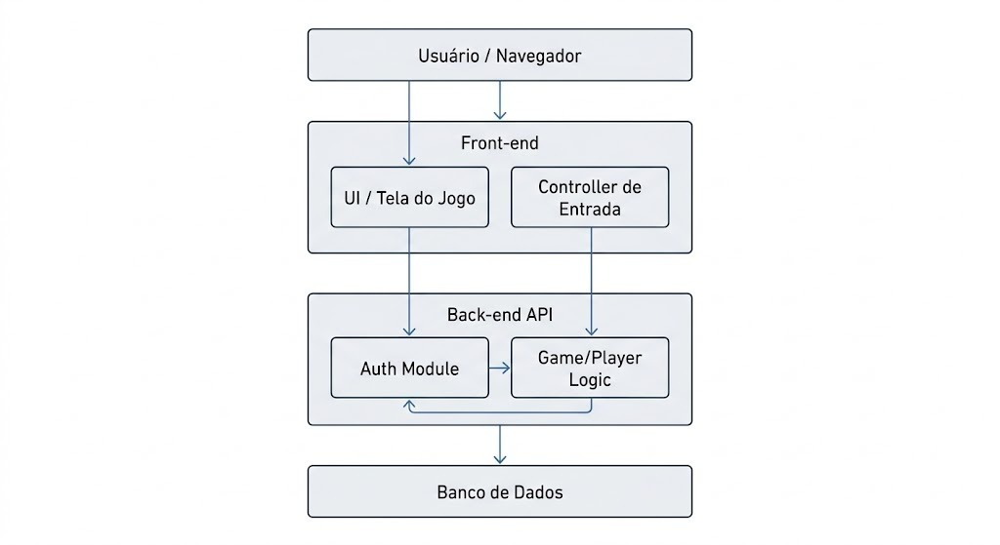

# Projeto em grupo da disciplina **Oficina 2**.

Ferramenta visual para programação de um pequeno personagem que se move pela tela usando comandos básicos: **frente, trás, direita e esquerda**.

## Equipe

| Nome | GitHub |
|------|--------|
| JOAO MARCOS ARAUJO | @joaomarcosaa |
| ROMULO AUGUSTO | @RotyDPD |
| GABRIEL DEROLDO | @Deroldo-21 |
| GABRIEL SUMIDA | @ |

## Tecnologias

| Parte | Tecnologia | Para que serve no projeto |
|-------|-----------|---------------------------|
| Front-end | HTML, CSS, JavaScript e Three.js | Login e labirinto 3D com câmera atrás do personagem |
| Back-end | Python com Flask | API de cadastro, autenticação, validação de conclusão e progresso |
| Banco de dados | SQLite com Flask-SQLAlchemy | Guardar usuários e resultados por fase |
| Autenticação | Login com Google (OAuth 2.0) | Permitir entrar com uma conta Google (RF02) |
| Testes automatizados | Pytest, Jest e node:test | Testar API, regras, fases, animação e câmera |
| Versionamento | Git e GitHub | Trabalho em equipe e histórico do código |

## Estrutura do repositório

```
.
├── backend/      # API em Python + testes com Pytest
├── frontend/     # Interface HTML/JS + testes com Jest
├── docs/         # Requisitos, arquitetura, guia de Git e backlog detalhados
├── imagens/      # Diagrama e outras imagens
└── .github/      # CI, templates de issue e de pull request
```

## Como rodar

### Back-end

No Windows PowerShell:

```powershell
cd backend
python -m venv .venv
.\.venv\Scripts\python.exe -m pip install -r requirements.txt
.\.venv\Scripts\python.exe -m flask --app app.main run --debug
```

No Linux ou macOS:

```bash
cd backend
python3 -m venv .venv
.venv/bin/python -m pip install -r requirements.txt
.venv/bin/python -m flask --app app.main run --debug
```
API em `http://127.0.0.1:5000` (teste: `/health`).

### Front-end
Com o back-end em execução, acesse `http://127.0.0.1:5000/`. O Flask serve a interface e a API na mesma origem.

### Login com Google (RF02)

O botão oficial do Google cria a conta no primeiro acesso e inicia uma sessão local. O servidor valida o token e sua audiência com `google-auth`, além do nonce da sessão. O Client ID de desenvolvimento já está configurado; para usar outro, defina `GOOGLE_CLIENT_ID` no ambiente antes de iniciar o Flask. Não é necessário Client Secret neste fluxo.

As origens usadas para abrir a aplicação devem estar autorizadas no cliente Web do Google Cloud (por exemplo, `http://127.0.0.1:5000` e `http://localhost:5000`). Se o e-mail já possuir uma conta local, entre com a senha; a vinculação automática de contas não é realizada.

Os testes de RF02 simulam a verificação do Google sem depender de contas ou da rede. A validação real do botão deve ser feita no navegador com uma conta Google.

## Testes

No Windows PowerShell, a partir da raiz do repositório:

```powershell
Push-Location backend
.\.venv\Scripts\python.exe -m pytest
Pop-Location
Push-Location frontend
npm ci
npm test
Pop-Location
```

No Linux ou macOS:

```bash
# Back-end
cd backend
.venv/bin/python -m pytest

# Front-end
cd ../frontend
npm ci
npm test
```

Node.js 20 ou superior é utilizado nos testes e scripts JavaScript. A interface é servida pelo Flask; os módulos Three.js necessários já acompanham o repositório em `frontend/vendor`.

## Banco de dados local

Na primeira execução, a aplicação cria as tabelas em `backend/instance/dados.db`. Esse arquivo não é enviado ao GitHub. Cada clone novo começa sem usuários nem progresso, mantendo as dez fases disponíveis no código. Reiniciar o servidor preserva o banco existente. O login Google identifica a conta; o progresso é armazenado no banco desta instalação.

## Guias técnicos

- [Versão atual do jogo 3D](docs/guia-versao-atual.md).
- [Protótipo 2D histórico](docs/guia-apresentacao-prototipo.md).
- [Arquitetura e responsabilidades](docs/arquitetura.md).

## Labirinto 3D

Após entrar, o jogo retoma a última fase liberada da conta. São dez labirintos com tamanho crescente, de 7 × 7 até 25 × 25 casas. A saída é um portal azul; ao alcançá-lo, o servidor valida o caminho, salva o progresso no SQLite e libera a próxima fase. Na fase 10, o jogo apresenta a conclusão da campanha e permite jogar novamente.

- **↑ / W:** andar para frente; **↓ / S:** andar para trás.
- **← / A** e **→ / D:** virar à esquerda e à direita. Os comandos são relativos à orientação do personagem.
- Os botões na tela também permitem jogar por toque.
- **M / Mapa:** mostrar ou ocultar o minimapa. Branco indica o personagem; azul indica a saída.
- **Reiniciar:** refazer a fase atual, sem apagar fases concluídas.

O número da fase fica no canto superior esquerdo. O modo 3D usa WebGL 2 e precisa de aceleração gráfica no navegador. O Three.js está versionado em `frontend/vendor`, com licença MIT; o jogo não depende de CDN. Para atualizar essa cópia depois de instalar dependências, execute `npm run vendor:three` em `frontend`.

As definições das fases ficam em `backend/app/levels.json`. O gerador determinístico e as regras testáveis ficam em `frontend/src/maze.js`; `npm run levels:generate` recria os mesmos dez labirintos. O back-end valida a conclusão percorrendo a sequência de comandos, não confiando na posição enviada pelo cliente.


## Arquitetura



O usuário acessa pelo navegador. O front-end (tela do jogo e controle de entrada) conversa com a API do back-end (autenticação e lógica do jogo), que guarda os dados no banco.

## Requisitos funcionais

| ID | Descrição | Prioridade |
|----|-----------|-----------|
| RF01 | O sistema deve permitir que o usuário crie uma conta. | Alta |
| RF02 | O sistema deve permitir autenticação utilizando uma conta Google. | Alta |
| RF03 | O sistema deve permitir iniciar uma atividade de movimentação do personagem. | Alta |
| RF04 | O sistema deve permitir executar comandos utilizando as setas do teclado. | Alta |
| RF05 | O sistema deve apresentar visualmente o deslocamento do personagem. | Alta |
| RF06 | O sistema deve permitir reiniciar a atividade. | Média |
| RF07 | O sistema deve apresentar instruções para a realização da atividade. | Média |
| RF08 | O sistema deve organizar a atividade em níveis de jogo com dificuldade crescente, liberando o próximo nível ao concluir o atual. | Média |
| RF09 | O sistema deve salvar o progresso do usuário e restaurá-lo em um novo acesso. | Alta |

