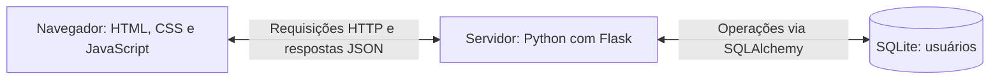

# Guia para explicar o protótipo publicado

Guia histórico do primeiro protótipo, conferido em 09/11/2026 no [commit 5ecdf87](https://github.com/joaomarcosaa/oficina2/tree/5ecdf873d249a458f9abee11ce60cf108fa2fdc1). Este documento descreve essa versão 2D. A evolução com jogo 3D, níveis, progresso e novo login é descrita no [guia da versão atual](guia-versao-atual.md).

## 1. O que o protótipo entrega

- Cadastro com nome, e-mail e senha.
- Login com e-mail/senha ou com Google.
- Identificação do usuário e logout.
- Grade 10 × 10 com um quadrado azul representando o personagem.
- Movimento por quatro botões ou setas, respeitando as bordas.
- Reinício da posição e instruções de uso.
- Testes automatizados e um workflow no GitHub Actions.

É uma aplicação web: funciona no navegador. O protótipo serve como base para testar autenticação, interação visual e organização técnica antes de desenvolver a experiência final.

## 2. Como as partes se relacionam

O movimento é calculado no próprio navegador. O banco dessa versão guarda usuários, não posições nem progresso. Front-end e back-end estão organizados em pastas diferentes, mas o Flask entrega os arquivos da interface e a API no mesmo endereço: `http://127.0.0.1:5000/`.

## 3. Front-end — o que a pessoa vê e utiliza

### Tecnologias

- **HTML:** estrutura das telas, campos, botões e grade.
- **CSS:** aparência e disposição dos elementos.
- **JavaScript:** comportamento: cliques, teclado, chamadas à API, troca de telas e atualização do personagem.

Não há React, Vue ou outra biblioteca de interface nessa versão. O HTML, o CSS e grande parte do JavaScript estão juntos em `frontend/index.html`. A lógica de movimento foi colocada em um arquivo separado para facilitar os testes.

### Arquivos principais

| Arquivo | Responsabilidade |
|---|---|
| `frontend/index.html` | Login, cadastro, jogo, estilos, eventos e integração com autenticação. |
| `frontend/src/movement.js` | Traduz setas em comandos e calcula a próxima posição. |
| `frontend/tests/movement.test.js` | Testa a lógica de movimento. |
| `frontend/package.json` | Declara o Jest e o comando `npm test`. |

### Como o personagem se move

O personagem tem uma posição `{ x, y }`, inicialmente `{ x: 0, y: 0 }`. Na grade, o canto superior esquerdo é a origem:

- Frente: diminui `y`.
- Trás: aumenta `y`.
- Direita: aumenta `x`.
- Esquerda: diminui `x`.

Uma seta ou botão vira um comando. A função `mover()` calcula a posição e limita os valores de `x` e `y` entre 0 e 9. Depois, `desenhar()` recria as 100 células e colore a que corresponde à posição do personagem.

Exemplo: de `{ x: 0, y: 0 }`, direita resulta em `{ x: 1, y: 0 }`. Esquerda a partir da origem mantém `{ x: 0, y: 0 }`, porque atingiria a borda.

Nessa versão, esquerda e direita deslocam lateralmente; não giram o personagem. O botão Reiniciar restaura a posição inicial. Atualizar a página também reinicializa a posição, pois ela existe somente na memória do JavaScript.

### Como conversa com o servidor

A função `chamarApi()` usa `fetch()` para enviar requisições. Os dados de cadastro/login são enviados em **JSON**, um formato de troca de dados. A resposta informa o usuário autenticado ou uma mensagem de erro.

Ao carregar a página, `/auth/me` verifica se há uma sessão válida. Depois de um cadastro bem-sucedido, o JavaScript chama a rota de login automaticamente e mostra o jogo.

## 4. Back-end — quem processa os pedidos

O back-end usa **Python com Flask**. Flask permite definir rotas: endereços que executam uma função quando o navegador faz uma requisição.

| Arquivo | Responsabilidade |
|---|---|
| `backend/app/main.py` | Cria/configura a aplicação, inicializa o banco, registra as rotas e entrega a interface. |
| `backend/app/auth.py` | Cadastro, login com senha, Google, consulta da sessão e logout. |
| `backend/app/models.py` | Define a classe `Usuario` e os campos da tabela. |
| `backend/app/extensions.py` | Disponibiliza a instância compartilhada do SQLAlchemy (`db`). |
| `backend/requirements.txt` | Lista as dependências Python. |

A função `create_app()` monta a aplicação. A autenticação fica em um **Blueprint**, que reúne rotas relacionadas em um módulo. É uma aplicação única organizada em partes, não um conjunto de microserviços.

### Rotas implementadas

| Método e rota | O que faz |
|---|---|
| `GET /` | Entrega a página inicial. |
| `GET /health` | Informa se a API responde. |
| `POST /auth/register` | Valida e salva uma nova conta. |
| `POST /auth/login` | Confere e-mail/senha e inicia a sessão. |
| `GET /auth/me` | Retorna o usuário da sessão atual. |
| `POST /auth/logout` | Encerra a autenticação local. |
| `GET /auth/google/config` | Entrega Client ID público e um valor temporário para vincular o token à sessão. |
| `POST /auth/google` | Verifica a credencial Google e autentica o usuário. |

`GET` consulta dados; `POST` envia dados para uma operação. A API responde com JSON e códigos HTTP, como 201 para cadastro criado, 400 para dados inválidos, 401 para falha de autenticação e 409 para e-mail já cadastrado.

## 5. Banco de dados e orientação a objetos

O banco implementado é **SQLite**, guardado em `backend/instance/dados.db`. Ele atende ao protótipo sem exigir a instalação de um servidor de banco separado. O README ainda cita PostgreSQL como possibilidade, mas essa não é a configuração atual.

A tabela `usuario` possui:

| Campo | Finalidade |
|---|---|
| `id` | Identificação interna. |
| `nome` | Nome exibido na interface. |
| `email` | E-mail único da conta. |
| `senha_hash` | Resultado da transformação da senha; pode ser nulo para uma conta Google. |
| `google_id` | Identificador único da conta Google. |
| `criado_em` | Data de criação. |

**SQLAlchemy** é o ORM: faz a ponte entre objetos Python e tabelas SQL. O código cria um `Usuario(...)`, adiciona com `db.session.add()` e confirma a gravação com `db.session.commit()`.

A orientação a objetos aparece na classe `Usuario`, que herda de `db.Model`, define atributos e possui o método `to_dict()`. Esse método retorna apenas `id`, `nome` e `email` para a interface. A lógica do personagem publicada ainda é feita com funções JavaScript, não com uma classe de personagem.

## 6. Cadastro, sessão e Google

### Cadastro com senha

1. A pessoa preenche os campos no front-end.
2. O JavaScript envia os dados para `/auth/register`.
3. O Flask valida nome, formato do e-mail, senha de pelo menos seis caracteres e e-mail duplicado.
4. Werkzeug transforma a senha em hash.
5. SQLAlchemy grava o usuário no SQLite.
6. O front-end faz uma segunda requisição para `/auth/login` e abre o jogo.

A senha não é guardada em texto puro. Hash não é uma senha criptografada para ser recuperada; na autenticação, a biblioteca verifica se a senha informada corresponde ao hash salvo.

### Manutenção do login

Ao autenticar, o código guarda `usuario_id` na sessão Flask. A configuração padrão usa um **cookie assinado** para manter essa informação entre requisições. `/auth/me` usa essa identificação para consultar o usuário. Logout remove a identificação da sessão.

### Login Google

1. O botão oficial do Google permite escolher a conta.
2. O Google entrega um token de identificação ao navegador.
3. O JavaScript envia o token para `/auth/google`.
4. A biblioteca `google-auth` verifica a credencial no back-end para o Client ID configurado. O código também confere o valor temporário da sessão, e-mail verificado e identificador do Google.
5. O servidor cria ou encontra a conta e inicia a sessão local.

O aplicativo não recebe a senha da conta Google. Se já houver cadastro local com aquele e-mail, a implementação orienta entrar com a senha local; não vincula as contas automaticamente.

## 7. Testes, Git e GitHub Actions

- **Pytest:** testa cadastro, autenticação, sessão, Google e disponibilidade da API. Os testes usam SQLite em memória.
- **Jest:** testa cálculo de movimento, alguns limites da grade, comando inválido e tradução de tecla em comando.
- **Git:** registra alterações em commits.
- **GitHub:** hospeda o repositório e reúne issues/pull requests.
- **GitHub Actions:** executa os testes automaticamente em pushes e pull requests para `main`.

O snapshot contém 24 casos de back-end, considerando as parametrizações, e quatro testes de front-end. Esta análise leu o código; não executou essa versão novamente. Os testes Google simulam a verificação do token, sem depender de uma conta real.

O Node.js e o npm são utilizados para as ferramentas de teste JavaScript. O servidor da aplicação é Python/Flask. O workflow publicado ainda não gera relatório de cobertura e os testes de movimento não cobrem toda a interface no navegador.

## 8. Implementado e planejado

| Implementado no GitHub | Planejado ou existente somente nas mudanças locais posteriores |
|---|---|
| Cadastro e autenticação | Labirinto e visual 3D. |
| Login Google | Dez fases com dificuldade crescente. |
| Movimento na grade 2D | Persistência de progresso por fase. |
| Limites e reinício | Validação de conclusão no servidor. |
| Testes e workflow de CI | Novo visual do login e melhorias de câmera. |

O documento `docs/arquitetura.md` publicado inclui rotas e tabelas de jogo identificadas como proposta/rascunho. Isso representa planejamento: o back-end desse commit ainda não tem rotas `/game/*` nem tabela de progresso.

## 9. Roteiro de apresentação oral

> Nosso projeto é uma ferramenta visual para trabalhar comandos básicos de movimentação. No protótipo, o personagem é representado por um quadrado em uma grade, que pode ser controlado pelas setas ou por botões.
>
> A interface foi feita com HTML, CSS e JavaScript. O JavaScript captura o comando, calcula a próxima posição e atualiza a grade. Essa lógica foi separada em um arquivo para facilitar os testes.
>
> O servidor foi desenvolvido em Python com Flask. Ele recebe as solicitações de cadastro e login, valida os dados e acessa o banco. O SQLite armazena os usuários, e o SQLAlchemy permite trabalhar com esses registros por meio da classe Usuario.
>
> As senhas são salvas como hash. Também temos login Google, com verificação do token no servidor. Depois de autenticar, a sessão permite identificar o usuário.
>
> Os testes usam Pytest no back-end e Jest no front-end. O GitHub Actions executa esses testes quando há alterações na main ou um pull request para ela.
>
> A versão publicada comprova o fluxo de autenticação e movimento básico. A próxima integração deve reunir as melhorias visuais, níveis e progresso, com revisão e divisão de tarefas entre os integrantes.

### Demonstração sugerida

1. Mostrar as pastas `frontend`, `backend`, `docs` e `.github`.
2. Abrir cadastro e criar uma conta de demonstração.
3. Mostrar entrada no jogo, botões, setas, limites e reinício.
4. Sair e demonstrar o login Google com uma conta adequada para a apresentação.
5. Mostrar `movement.js`, uma rota de `auth.py` e a classe `Usuario`.
6. Executar os testes e mostrar o workflow do GitHub Actions.
7. Encerrar com funcionalidades entregues e próximos passos acordados pelo grupo.

Para mostrar exatamente o protótipo publicado, usar um clone separado no commit `5ecdf87`. Executar a aplicação na pasta atual de trabalho pode mostrar a versão local mais avançada. O clone separado preserva essas alterações para revisão posterior pela equipe.
