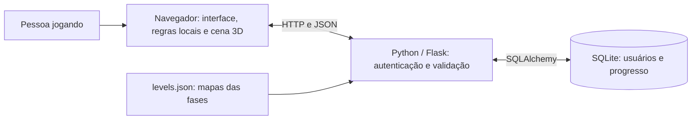

# Guia da versão atual — Labirinto Game

Guia da versão 3D preparada para publicação em 09/11/2026. Ela inclui login temático, jogo 3D, dez fases, câmera em terceira pessoa e progresso por usuário. O protótipo 2D anterior permanece acessível no commit `5ecdf87` para comparação com esta versão.

## 1. Visão geral

É uma aplicação web de exploração de labirintos para trabalhar orientação e comandos básicos. O usuário entra na conta, controla um robô, encontra o portal de saída e libera a próxima fase. A campanha possui dez mapas crescentes. O progresso concluído fica associado à conta.

As responsabilidades são divididas entre navegador, servidor e banco:



O servidor Flask entrega tanto os arquivos da interface quanto as rotas da API. A página e a API usam o mesmo endereço, normalmente `http://127.0.0.1:5000/`. A aplicação é organizada em módulos e responsabilidades; não existe uma implantação independente para cada arquivo.

## 2. Tecnologias e suas funções

| Tecnologia | Categoria | Aplicação concreta |
|---|---|---|
| HTML | Linguagem de marcação | Estrutura dos formulários, botões, canvas, indicadores e janelas de conclusão. |
| CSS | Estilos | Layout responsivo, painel roxo, detalhes neon e interface do jogo. |
| JavaScript | Linguagem | Comandos, regras de movimento, integração com a API e animação. |
| Three.js 0.186.1 | Biblioteca JavaScript 3D | Montagem da cena, personagem, câmera, luzes, materiais e desenho 3D. |
| WebGL 2 | Recurso gráfico do navegador | Permite ao Three.js desenhar a cena usando a GPU. |
| Canvas 2D | Recurso do navegador | Desenho do minimapa. |
| Python | Linguagem | Implementação do servidor. |
| Flask | Framework web | Rotas HTTP, configuração, respostas JSON, entrega de arquivos e sessões. |
| SQLite | Banco relacional | Persistência de usuários e fases concluídas. |
| Flask-SQLAlchemy / SQLAlchemy | Integração e ORM | Representação das tabelas por classes e operações de banco no Python. |
| Werkzeug | Biblioteca | Hash e verificação de senhas. |
| Google Identity Services | Serviço/biblioteca do Google | Botão oficial e obtenção da credencial de identificação. |
| google-auth | Biblioteca Python | Verificação do token Google no servidor. |
| Pytest | Ferramenta de testes | Testes da API, autenticação e progresso. |
| Jest | Ferramenta de testes | Testes das regras JavaScript e dos mapas. |
| node:test | Ferramenta de testes do Node.js | Testes do movimento visual e colisão da câmera em `.mjs`. |
| Node.js e npm | Ambiente e gerenciador de pacotes | Testes, dependências JavaScript e scripts de geração/cópia de recursos. |
| Git, GitHub e GitHub Actions | Versionamento e automação | Commits, issues, trabalho em grupo e execução automatizada de testes. |

O código Python executa o servidor. O JavaScript do jogo executa no navegador. Node.js não é o servidor desta aplicação. Os módulos 3D são carregados pelo navegador diretamente, sem exigir um bundler na execução do Flask.

## 3. Estrutura das pastas

```text
oficina2/
├── frontend/
│   ├── index.html
│   ├── src/
│   │   ├── login-theme.css
│   │   ├── login-preview.js
│   │   ├── login-maze.svg
│   │   ├── game.css
│   │   ├── game.js
│   │   ├── maze.js
│   │   ├── scene3d.js
│   │   └── scene-motion.mjs
│   ├── vendor/
│   │   ├── three.module.js
│   │   ├── three.core.js
│   │   └── THREE-LICENSE.txt
│   ├── scripts/
│   │   ├── generate-levels.cjs
│   │   └── vendor-three.cjs
│   ├── tests/
│   │   ├── movement.test.js
│   │   ├── maze.test.js
│   │   └── scene-motion.test.mjs
│   ├── package.json
│   └── package-lock.json
├── backend/
│   ├── app/
│   │   ├── __init__.py
│   │   ├── main.py
│   │   ├── auth.py
│   │   ├── game.py
│   │   ├── models.py
│   │   ├── extensions.py
│   │   └── levels.json
│   ├── instance/dados.db
│   ├── tests/
│   │   ├── test_auth.py
│   │   ├── test_google_auth.py
│   │   ├── test_game.py
│   │   └── test_health.py
│   ├── pytest.ini
│   └── requirements.txt
├── docs/
├── imagens/
├── scripts/criar-issues.sh
├── .github/
│   ├── ISSUE_TEMPLATE/
│   ├── pull_request_template.md
│   └── workflows/ci.yml
├── .gitignore
└── README.md
```

O banco em `instance` é criado localmente e ignorado pelo Git. A árvore acima destaca o código atual. Há também arquivos de versões anteriores, como `movement.js`, `character.css`, `console.svg` e `login.css`. O jogo 3D usa `maze.js` e `scene-motion.mjs`; a página atual carrega `login-theme.css`. Os testes antigos de `movement.js` ainda são executados.

`docs` reúne requisitos, arquitetura, níveis, guia de Git e planejamento. `imagens` contém o diagrama inicial. `scripts/criar-issues.sh` é um utilitário de apoio ao GitHub, separado da execução do jogo.

## 4. Front-end, arquivo por arquivo

### `index.html`

É a entrada da interface. Define login, cadastro, área 3D, minimapa, indicadores e janela de conclusão. Também contém o JavaScript da autenticação: chama a API com `fetch`, troca as telas e carrega os módulos do jogo e da prévia quando necessários.

### `login-theme.css`, `login-preview.js` e `login-maze.svg`

O CSS define o novo visual. A prévia reutiliza a mesma classe de cena 3D do jogo e mostra a fase inicial sem iniciar uma partida nem alterar progresso. Ela é limitada a 30 quadros por segundo, pausa fora da área visível ou com a aba/login ocultos e respeita a preferência de movimento reduzido.

O SVG é uma ilustração vetorial estática do labirinto. Ele permanece disponível se a prévia WebGL não carregar.

### `game.css`

Cuida dos elementos de interface sobre a cena: fase no canto superior esquerdo, botões, contador, instruções, minimapa e diálogo. Essa sobreposição é o HUD: informações apresentadas ao jogador durante a partida.

### `game.js`

Coordena a partida. Recebe teclado ou toque, solicita fases ao servidor, aplica comandos, atualiza o HUD/minimapa e envia a sequência de comandos ao concluir uma fase. Mantém os estados de carregamento, tentativa atual e salvamento, além de interromper a animação ao sair.

Ele funciona como controlador: conecta interface, regras, renderização e API.

### `maze.js`

Define as regras sem depender do desenho 3D. Armazena posição, orientação, movimentos e conclusão. Frente/trás deslocam conforme a orientação; direita/esquerda giram 90 graus. Parede ou borda bloqueia o deslocamento.

Também contém o gerador determinístico de mapas e a definição de dez fases. As funções independentes permitem testar o jogo sem abrir um navegador.

### `scene3d.js`

A classe `CenaLabirinto` cria o mundo gráfico:

- `Scene`: coleção dos objetos.
- `PerspectiveCamera`: ponto de vista atrás do personagem.
- `WebGLRenderer`: desenha os objetos no canvas.
- Geometrias: caixas, esferas, cápsulas e anéis.
- Materiais: cores, brilho, rugosidade e transparência.
- Luzes, neblina, estrelas, portal e sombra de contato.

O robô é construído com essas formas e grupos articulados. Braços e pernas são animados conforme o deslocamento. O mundo é redesenhado em um laço de animação enquanto a partida está ativa.

As paredes são agrupadas com `InstancedMesh`, que reutiliza geometrias para desenhar muitos blocos com poucas chamadas de renderização. Elas permanecem sólidas e visíveis; a câmera se ajusta aos obstáculos.

### `scene-motion.mjs`

A classe `PassoVisual` transforma mudanças discretas da grade em passos suaves. A regra diz qual é a próxima casa; esta classe calcula as posições intermediárias até chegar exatamente ao centro.

Ela impede sobrepor um novo passo ao anterior e escolhe o caminho angular curto nas viradas. A animação depende do tempo, e não de um número fixo de quadros. A função `limitarCamera()` verifica o segmento entre personagem e câmera contra caixas das paredes, preservando uma margem antes do obstáculo.

## 5. Como a grade vira um mundo 3D

O mapa continua sendo uma matriz simples:

```text
#####
#...#
#.#.#
#...#
#####
```

Este é apenas um exemplo didático: `#` representa parede e `.` representa caminho. Os mapas reais têm de 7 × 7 a 25 × 25 casas.

Nas regras, `x` é a coluna e `y` é a linha. Na cena Three.js, a coluna vira o eixo horizontal `X`, a linha vira o eixo `Z` e a altura dos objetos usa `Y`. Cada casa mede 2,6 unidades gráficas.

Assim, a regra continua simples e testável, enquanto o renderizador cria o cenário tridimensional. A colisão do personagem é calculada pela grade; o projeto não depende de uma simulação completa de física.

## 6. Como as dez fases são criadas

O gerador usa busca em profundidade com retorno, chamada DFS/backtracking: abre um caminho, continua por casas ainda não visitadas e volta quando chega a um ponto sem novas opções.

Uma semente controla os sorteios. Isso permite recriar os mesmos mapas em vez de produzir um labirinto diferente a cada login. Uma busca em largura, BFS, encontra uma casa distante alcançável e calcula o menor caminho até ela. A campanha seleciona mapas cujo menor caminho cresce a cada fase.

Os tamanhos são 7, 9, 11, 13, 15, 17, 19, 21, 23 e 25 casas de lado. O script `generate-levels.cjs` gera o arquivo `backend/app/levels.json`, que contém os mapas usados pela API, com início, orientação inicial, meta e menor número de movimentos.

O JSON contém dados, não uma tabela de usuários ou progresso. As fases são fixas e compartilhadas; o progresso de cada pessoa é armazenado no banco.

## 7. Back-end

### `main.py`

A função `create_app()` configura a aplicação, o SQLite e a sessão. Inicializa o SQLAlchemy, registra os Blueprints de autenticação e jogo e cria as tabelas ainda inexistentes. A rota `/` entrega o HTML e `/health` informa se a API responde.

### `auth.py`

Valida cadastro, confere hash de senha, inicia/encerra sessão e verifica o token Google. A sessão padrão Flask é mantida por cookie assinado com a identificação do usuário. As respostas públicas não incluem senha nem hash.

### `game.py`

Carrega os mapas, exige autenticação, consulta o progresso e protege fases ainda bloqueadas. Antes de salvar uma conclusão, percorre todos os comandos desde a posição inicial e verifica paredes, limites, orientação e chegada à meta. O número de movimentos é calculado pelo servidor.

O decorador `@autenticado` reúne a verificação de login usada nas rotas de jogo. O progresso consultado é filtrado pelo usuário da sessão.

### Rotas atuais

| Rota | Finalidade |
|---|---|
| `GET /` | Página da aplicação. |
| `GET /health` | Disponibilidade da API. |
| `POST /auth/register` | Cadastro. |
| `POST /auth/login` | Login por e-mail/senha. |
| `POST /auth/logout` | Logout. |
| `GET /auth/me` | Usuário autenticado. |
| `GET /auth/google/config` | Configuração pública e valor temporário para o login Google. |
| `POST /auth/google` | Validação da credencial Google e sessão local. |
| `GET /game/progress` | Fases concluídas, última fase liberada e melhores resultados. |
| `GET /game/levels/<id>` | Mapa de uma fase liberada. |
| `POST /game/levels/<id>/complete` | Validação do caminho e gravação da conclusão. |

Não é feita uma requisição a cada movimento. O navegador oferece resposta imediata e o servidor valida o caminho no momento de salvar a conclusão. Rotas como `/game/move` presentes em rascunhos antigos não estão implementadas nem são necessárias para esse fluxo atual.

## 8. Banco de dados

O SQLite possui duas tabelas principais, mapeadas em `models.py`:

| Tabela | Campos |
|---|---|
| `usuario` | `id`, `nome`, `email`, `senha_hash`, `google_id`, `criado_em`. |
| `progresso` | `id`, `usuario_id`, `nivel_id`, `melhor_movimentos`. |

`usuario_id` é uma chave estrangeira: relaciona o resultado ao usuário. A combinação usuário/fase é única, evitando vários registros para o mesmo resultado lógico.

Uma linha em `progresso` indica que aquela fase foi concluída. O servidor deriva o próximo nível liberado das fases concluídas. Refazer um nível mantém o menor número de movimentos entre as tentativas.

Não há uma gravação de cada passo ou da posição exata de uma tentativa interrompida. Ao entrar novamente, a pessoa começa a última fase liberada do início.

## 9. Fluxo de uma partida

1. A pessoa autentica com senha ou Google.
2. `index.html` mostra a área do jogo e carrega `game.js`.
3. O controlador consulta `/game/progress` e solicita o mapa liberado.
4. `CenaLabirinto` monta o mundo e o personagem.
5. Teclas/botões viram comandos; `maze.js` verifica a regra.
6. `PassoVisual` anima a mudança e a câmera acompanha.
7. O HUD e o minimapa recebem a nova posição e a contagem.
8. Ao alcançar a meta, o navegador envia a sequência de comandos.
9. O servidor valida a sequência e grava o resultado no SQLite.
10. Após confirmação do salvamento, a interface permite avançar. Na fase 10, apresenta a conclusão e permite jogar novamente.

Frente/trás contam deslocamentos; giros não aumentam o contador de movimentos. Os controles são setas, WASD ou botões. M mostra/oculta o minimapa. Reiniciar refaz a tentativa e preserva fases concluídas.

## 10. Orientação a objetos no projeto

| Classe | Responsabilidade |
|---|---|
| `Usuario` | Modelo dos dados da conta. |
| `Progresso` | Modelo do resultado por fase e usuário. |
| `CenaLabirinto` | Organização dos objetos gráficos, câmera e renderização. |
| `PassoVisual` | Estado e evolução temporal de um passo ou giro. |

O projeto combina classes e funções. As funções de regra são independentes do desenho para facilitar testes; a classe visual encapsula os detalhes da animação. A herança aparece nos modelos que estendem `db.Model`. As classes Three.js são utilizadas por composição dentro de `CenaLabirinto`.

## 11. Testes e automação

Em 09/11/2026, foram executados com sucesso **65 testes**: 36 no back-end, 17 no Jest e 12 no executor de testes Node.js.

| Arquivo de teste | O que verifica |
|---|---|
| `test_auth.py` | Cadastro, login, sessão e logout. |
| `test_google_auth.py` | Criação/reutilização Google, credenciais inválidas e nonce. |
| `test_game.py` | Dez fases, bloqueios, conclusão validada, isolamento, persistência e melhor resultado. |
| `test_health.py` | Resposta da API. |
| `movement.test.js` | Lógica do protótipo 2D preservada. |
| `maze.test.js` | Mapas reproduzíveis e crescentes, caminhos válidos, comandos e colisões. |
| `scene-motion.test.mjs` | Passos exatos, viradas sem diagonal, taxas de quadros e colisão da câmera. |

Os testes Python usam SQLite em memória, preservando o banco utilizado na aplicação. Os testes Google simulam a verificação externa. Esses testes não substituem a conferência visual do navegador nem constituem cobertura completa das telas.

O workflow em `.github/workflows/ci.yml` executa `pytest` e `npm test` em pushes e pull requests para `main`. As novas verificações entram no CI quando seus arquivos forem versionados e enviados. A medição de cobertura ainda precisa ser configurada.

## 12. Arquivos de ambiente e dependências

- `requirements.txt`: bibliotecas Python a instalar.
- `.venv`: ambiente Python local, ignorado no Git.
- `package.json`: dependências e comandos JavaScript.
- `package-lock.json`: versões resolvidas pelo npm.
- `node_modules`: dependências instaladas localmente, ignoradas pelo Git.
- `vendor`: cópia dos módulos Three.js usados no navegador, acompanhada da licença MIT. Ela é atualizada pelo script `vendor-three.cjs`.
- `.gitignore`: exclui ambientes, caches, banco local e arquivos de segredos do versionamento.
- `.mjs`: módulo JavaScript com import/export explícitos, usado no movimento e seus testes.
- `.cjs`: scripts CommonJS executados pelo Node.js, usados nas tarefas de apoio.
- `.json`: dados ou configuração estruturada.
- `.svg`: imagem vetorial.

Os recursos 3D são servidos pelo Flask a partir de `vendor`; não é necessário baixar Three.js de uma CDN durante uma partida. A autenticação Google continua dependendo do serviço Google.

## 13. Como explicar ao professor e à equipe

> A versão atual é uma aplicação web em camadas. O front-end usa HTML, CSS e JavaScript, com Three.js para criar o labirinto 3D e a câmera atrás do personagem. Separar regras, controle da partida e renderização permite testar as regras sem depender da tela.
>
> Os dez mapas são gerados de forma reproduzível e armazenados em JSON. O navegador calcula os movimentos para responder rapidamente. Ao concluir uma fase, envia os comandos para o back-end Python com Flask, que refaz a validação e registra o progresso.
>
> Os usuários e resultados são armazenados no SQLite por meio das classes SQLAlchemy. A aplicação possui cadastro, login Google, bloqueio de fases futuras e recuperação do progresso por conta.
>
> Temos testes para autenticação, regras, campanha, persistência e movimento visual. Os próximos cuidados de integração são conferir as telas no navegador, completar cobertura e manter requisitos e tarefas atualizados.

Para a equipe estudar o código, uma ordem útil é: `index.html` → `game.js` → `maze.js` → `scene3d.js` e `scene-motion.mjs` → `backend/app/game.py` → `models.py` → testes. A autenticação pode ser estudada separadamente em `auth.py`.
